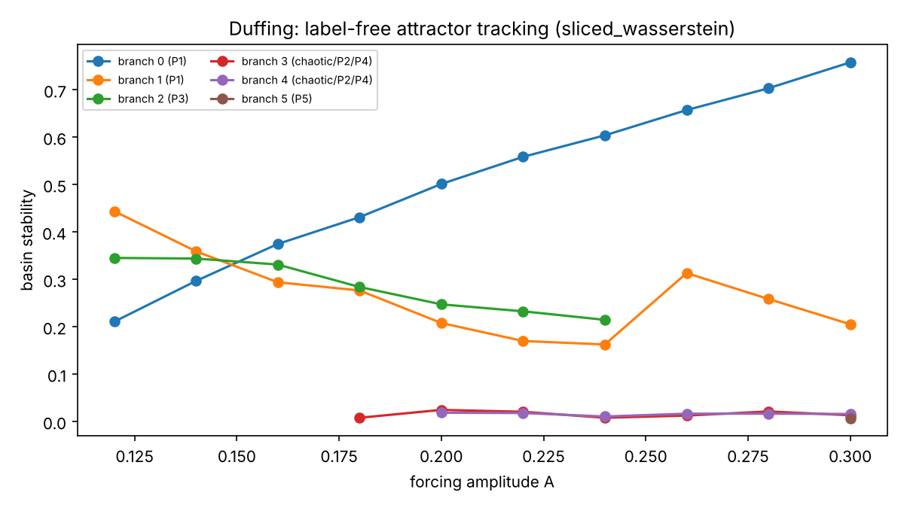

# Neural representations for attractor discovery

Can a neural time-series model replace PyBasin's hand-picked features for finding attractors
without labels? This folder compares pretrained foundation models, a self-supervised encoder,
PyBasin's own feature pipelines and two measure-based embeddings. Every representation goes
through the same unsupervised clusterer, and none is tuned per system.

## Setup

**Data.** There are two groups of systems.

- The four PyBasin case studies: Duffing (5 periodic attractors), pendulum, friction and Lorenz
  (two chaotic attractors). Labels are the bSTAB reference labels from
  `tests/integration/*/ground_truths`. `generate_data.py` produces this data.
- Eleven systems from [BasinsCollection](https://github.com/awage/BasinsCollection) that
  no trained model sees: Duffing at ω = 1.15, a forced pendulum, a parametric pendulum, a
  split-ring resonator, megastable Sprott (9 attractors), Thomas, Lorenz-84, Li–Sprott,
  Rikitake, a magnetic pendulum and a gyrostat. `basins_collection/generate.jl` takes the
  equations, parameters, solver settings and recurrence-mapper configuration from each
  collection script. Labels come from Attractors.jl's `AttractorsViaRecurrences`, an
  algorithm that shares nothing with the representations under test.

Each trajectory is a steady-state window. Forced systems get 12 forcing periods at 64 samples
per period, starting at forcing phase 0. Autonomous systems get 1000 samples after a long
transient.

**Representations** (`representations.py`, `contrastive.py`):

| name | what it is |
|---|---|
| Chronos-Bolt, Chronos-2 | pretrained forecasting models (`amazon/chronos-bolt-small`, `amazon/chronos-2`), mean-pooled encoder embedding, zero-shot |
| + loc/scale | the same, with each series' mean and log-std appended (Chronos standardises every input series) |
| Contrastive CNN | dilated 1-D CNN, SimCLR/InfoNCE on random crops of the same trajectory, channel-independent, inputs scaled with pooled dataset statistics; trained on **Duffing only** or on **all four case studies**, never on validation systems |
| Set encoder | DeepSets encoder over delay vectors of each state channel, order-invariant and therefore phase-invariant; trained like the CNN, or left untrained (section 5) |
| PyBasin DefaultFeatureExtractor | 10 statistics per state |
| PyBasin DynamicalSystemClusterer | PyBasin's rule-based FP/LC/chaos classifier on `DYNAMICAL_SYSTEM_FEATURES_CONFIG` (it does its own grouping) |
| Sliced-Wasserstein measure | quantiles of the trajectory's state-space samples along 16 random directions plus the state axes; Euclidean distance between two embeddings is the sliced 2-Wasserstein distance between their empirical invariant measures |
| Stroboscopic section | sorted states at forcing phase 0 (forced systems only) |

**Scoring** (`common.py`). Each embedding is standardised and PCA-reduced to 16 dimensions.
Two questions get separate scores:

- *Is the attractor identity in the representation?* 5-fold 1-NN balanced accuracy.
- *Can it be found without labels?* PyBasin's default clusterer
  (`TunedClusterer(HDBSCANClusterer, MinClusterSizeSearch)`), scored by adjusted Rand index
  (ARI), number of clusters found, and the largest basin-stability error after optimal
  cluster-to-attractor matching.

## Results

### 1. The information is always there; the clustering is where methods differ

1-NN accuracy is 1.00 for every representation on all four case studies and all eleven
validation systems. The one exception is Rikitake at 0.66, where one recurrence-mapper
"attractor" holds a single trajectory. That includes zero-shot Chronos and the encoder trained
on Duffing alone. Telling attractors apart *given a few labelled examples* is easy for all of
them, so a supervised probe or a 1-NN check cannot show whether a learned model generalises.
Recovering the attractors without labels is what separates the methods.

### 2. Validation on 11 unseen systems

| representation | mean ARI | systems with ARI > 0.9 | median clusters found (true ≈ 3) | mean max BS error | silhouette (true labels) |
|---|---|---|---|---|---|
| **Sliced-Wasserstein measure** | **0.82** | **6 / 11** | **4** | **0.09** | **0.75** |
| PyBasin DefaultFeatureExtractor | 0.67 | 5 / 11 | 8 | 0.18 | 0.65 |
| Contrastive CNN (Duffing only) | 0.63 | 4 / 11 | 6 | 0.20 | 0.64 |
| Contrastive CNN (4 case studies) | 0.59 | 3 / 11 | 15 | 0.23 | 0.61 |
| Stroboscopic section (5 forced systems) | 0.54 | 1 / 5 | 9 | 0.28 | – |
| Chronos-Bolt (± loc/scale) | 0.51 | 3 / 11 | 32 | 0.25 | 0.38 |
| PyBasin DynamicalSystemClusterer | 0.46 | 1 / 11 | 7 | 0.28 | – |
| Chronos-2 (± loc/scale) | 0.45 | 3 / 11 | 9 | 0.26 | 0.44 |

Per-system numbers are in `results/scores_validation.csv` and
`results/silhouette_validation.csv`. The four case studies are in `results/scores_w1_n0.csv`.

- **The Duffing-trained contrastive encoder transfers about as well as the one trained on four
  systems** (ARI 0.63 against 0.59). Training on Duffing did not overfit in a way that hurts
  other systems. More training systems did not help either. Neither encoder beats PyBasin's
  20 fixed statistics.
- **Pretrained foundation models over-split badly.** Chronos-Bolt finds a median of 32 clusters
  where about 3 exist. On chaotic attractors (Thomas, Rikitake, Lorenz-84) and on several
  forced systems, each attractor becomes a spread-out cloud. The silhouette under the true
  labels is 0.38–0.44, against 0.75 for the measure embedding. Appending the location and scale
  that Chronos normalises away changes nothing measurable here.
- **PyBasin's DynamicalSystemClusterer is perfect on its own four case studies (ARI 1.0) but
  drops to 0.46 on unseen systems.** Its default thresholds encode knowledge of those four
  systems. This is the generalisation problem from the original motivation, measured.
- **Split-ring resonator and megastable Sprott stay hard for every method.** The best ARI on
  the split-ring resonator is 0.23; on megastable Sprott it is 0.85, but no method finds its
  nine attractors without extra clusters.

### 3. Why neural embeddings over-split: they encode the phase, not the attractor

On PyBasin's Duffing case, Chronos and the contrastive CNN split the period-3 attractor ȳ5 into
three clusters of 347, 307 and 371 trajectories. Those sizes match exactly the three possible
phases of the period-3 orbit relative to the forcing at the window start. The period-2
attractors ȳ3 and ȳ4 split the same way, 49/61 and 52/53. In the extended phase space these
are one closed orbit observed from a different starting point. Any encoder that reads a window
as a sequence sees them as different signals.

An embedding of the trajectory's *distribution* of states is invariant to this phase by
construction. That is why the sliced-Wasserstein embedding keeps each attractor together. It
also converges as the window grows, because a longer window samples the same invariant
measure more densely. A neural encoder's output on a chaotic window, by contrast, depends on
which piece of the attractor the window happened to cover.

The window length interacts with this. With a 15-forcing-period window, which is 7.5 cycles of
a period-2 orbit, even the measure embeddings split the period-2 attractors by phase
(`results/duffing_15_periods_window.csv`). Twelve periods is a multiple of 1, 2, 3 and 4, which
avoids that. For unknown periods a longer window shrinks the effect but does not remove it.

### 4. Label-free attractor tracking across a parameter

`continuation.py` sweeps the Duffing forcing amplitude A from 0.12 to 0.30. At each A it
clusters the sliced-Wasserstein embeddings with the same fixed clusterer. It then links each
cluster to the one at the neighbouring A whose median embedding is closest, using a ratio test
against the next-best candidate.



Without labels or a known number of attractors, this recovers:

- the two period-1 branches;
- the period-3 attractor disappearing after A = 0.24, with its basin going to the small
  period-1 attractor;
- a symmetric pair born near A = 0.18 that goes period-2 → period-4 → chaotic → period-4 →
  period-2, a period-doubling bubble;
- a period-5 attractor appearing at A = 0.30.

The period labels come from counting distinct stroboscopic points of each cluster's medoid
trajectory. None of this replaces numerical continuation: unstable branches are invisible to
any method that only simulates forward in time.

### 5. A phase-invariant neural encoder

`set_encoder.py` is built around the invariance section 3 identified. For each state channel,
every time point becomes a delay vector `(x(t), x(t+4), x(t+16), x(t+64))`. A shared MLP embeds
each vector, and mean and max pooling over the window make the result independent of sample
order (a DeepSets encoder). Shifting the window then only changes which points of the attractor
were sampled, not how they are arranged. Training uses the same InfoNCE objective as the CNN.
The two views of a trajectory are random point subsets from two independent random sub-windows
covering 50–100 % of the window. Three variants are scored: trained on Duffing only, trained on
the four case studies, and **untrained** (random weights). The untrained variant separates what
the architecture gives from what training adds. `evaluate_extended.py` scores all of them on
the 15 systems under three observation conditions: the full window, its trailing quarter
(3 forcing periods or 250 samples), and additive noise at 5 % of each state's pooled standard
deviation. Encoders are always trained on clean full-window case-study data.

**Repairing noise-scale splits.** On BasinsCollection's Duffing (ω = 1.15), every neural encoder
scored ARI 0.35 with about 32 clusters. The cause is not the representation. Trajectories on one
periodic attractor are identical to about 1e-6, and their embeddings spread by about 1e-5 while
attractor centroids sit about 16 apart. HDBSCAN splits such near-degenerate clusters at
numerical-noise scale. `common.merge_close_clusters` merges clusters whose closest members are
less than ε apart. ε = 0.1 is far below any attractor separation in the standardised 16-D
embeddings, so it repairs these splits without acting as a tuning knob. At that value no
representation's mean ARI drops, and Duffing (ω = 1.15) goes to 1.00 for every neural encoder.
Larger ε starts to merge real structure: at ε = 1.0 the default features fix the forced pendulum
(0.25 → 1.00) because their feature space happens to suit that merge. Hence ε = 0.1 below
(`clusterer_sensitivity.py`). sklearn's own `cluster_selection_epsilon` raises a `TypeError` in
the pinned version, which is why the merge is a separate step.

Mean ARI over the 11 unseen systems (`results/clusterer_sensitivity_<condition>.csv`):

| representation | full window | ¼ window | 5 % noise |
|---|---|---|---|
| Set encoder (trained on 4 case studies) | 0.84 | **0.73** | 0.86 |
| Set encoder (trained on Duffing only) | **0.85** | **0.73** | 0.86 |
| Set encoder (untrained) | **0.85** | 0.66 | 0.87 |
| Sliced-Wasserstein measure | 0.84 | 0.62 | **0.88** |
| PyBasin DefaultFeatureExtractor | 0.79 | 0.70 | 0.87 |
| Contrastive CNN (Duffing only / 4 case studies) | 0.69 / 0.65 | 0.63 / 0.59 | 0.86 / 0.80 |
| Chronos-Bolt / Chronos-2 | 0.59 / 0.53 | – | – |

Chronos was evaluated in the full-window condition only, for compute reasons.

- **Phase invariance is what makes a neural encoder work here.** The set encoder ties the
  measure embedding on full windows. The positional CNN, trained with the identical objective
  and data, stays 0.15–0.20 behind. Chronos's failures on chaotic attractors (Rikitake 0.03,
  Thomas 0.06–0.11) and on megastable Sprott (0.16–0.19) survive the cluster repair, so its
  embeddings genuinely smear each attractor out.
- **On full windows, training adds nothing; the architecture does the work.** The untrained set
  encoder scores 0.85, the same as the trained ones.
- **On short windows, training is what helps.** The trained set encoders lead (0.73) and beat
  their untrained copy (0.66) and the measure embedding (0.62). The training views were random
  sub-windows, so the encoder learned to ignore which part of the attractor a short window
  covers. The measure embedding's empirical distribution gets noisy at 250 samples and
  over-splits. This is the one setting in these experiments where self-supervised learning
  beats a training-free method.
- **Training on Duffing alone transfers as well as training on four systems** under every
  condition, so more training systems neither help nor hurt at this scale.
- **Noise raises clustering scores for every method** (mean ARI 0.80–0.88) while slightly
  lowering 1-NN accuracy. Noise gives collapsed periodic clusters a finite density, which
  removes the HDBSCAN failure above; ε has no further effect there. This again points to the
  clusterer, not the representations, as the main failure on the full-window systems.
- **Two systems stay unsolved by everything:** the split-ring resonator (best 0.23) and the
  forced pendulum (best 0.78 at ε = 0.1).

## Answers to the research questions

- **Attractor identity.** Every representation tested separates attractors that share a
  dynamical classification, including symmetric pairs and chaotic twins. Separability is not
  the bottleneck.
- **Generalisation and transfer.** Generic pretrained forecasters (Chronos) and positional
  encoders do not transfer: their embeddings encode the orbit's phase and the slice of a chaotic
  attractor a window covers, and a fixed clusterer turns that into spurious attractors. A
  phase-invariant set encoder trained only on PyBasin's Duffing transfers to 11 unseen systems
  as well as one trained on four systems (mean ARI 0.85 with noise-split repair). Duffing
  success alone was never evidence of learning: plain max/std separates Duffing's attractors
  just as well.
- **Feature engineering.** The phase-invariant encoder with random weights already matches the
  sliced-Wasserstein embedding and beats PyBasin's default statistics (0.85 against 0.79). The
  invariance is what removes the hand-picked features; training adds robustness to short
  windows.
- **Automatic clustering.** The number of attractors comes out right when within-attractor
  scatter is small compared with between-attractor distance. PyBasin's default HDBSCAN setup
  has one systematic failure on top of that: it shatters the near-degenerate clusters that
  phase-locked periodic attractors produce. Merging clusters below a fixed tiny distance (or
  any small noise) fixes it for every representation.
- **Robustness.** With short windows the self-supervised set encoder is the most robust method
  tested. With 5 % noise all reasonable methods converge to mean ARI ≈ 0.86–0.88.
- **Continuation.** The measure embedding links attractors across a parameter sweep and reveals
  births, deaths and a period-doubling bubble.

## Caveats

- One clusterer configuration throughout, plus the fixed ε = 0.1 merge in section 5, which is
  the point of the comparison. A representation could look better under a clusterer tuned
  for it.
- The encoders are small (CPU training, 600 steps). A larger SimCLR run could change the
  contrastive rows, but not the phase argument in section 3.
- The set encoder's delay lags (4, 16, 64 samples) are fixed and shared across systems. Since
  sampling rates differ between systems, the lags cover different physical time scales on
  each one.
- Ground truth on BasinsCollection is the recurrence mapper's label for the attractor each
  trajectory's window ends on. Labelling initial conditions directly disagreed for 27 % of
  weakly damped Duffing (ω = 1.15) trajectories (see `generate.jl`). Rikitake contains one
  single-trajectory label that is probably a mapper artefact.
- `DynamicalSystemClusterer` currently cannot read the column names that
  `TorchFeatureExtractorAdapter` produces for `DYNAMICAL_SYSTEM_FEATURES_CONFIG`: the names
  contain `__min_lag_2__peak_threshold_0.3`. The experiments strip that suffix. The case-study
  script `main_duffing_dynamical_clusterer.py` fails on it as is.

## Reproducing

```bash
uv sync --no-default-groups --group complete --group case-studies --group dev
uv pip install chronos-forecasting
cd experiments/neural_attractors
python generate_data.py
python evaluate.py                    # four case studies, about 1 h on 4 CPU cores
cd basins_collection && julia --project=. -e 'using Pkg; Pkg.instantiate()' \
    && julia --project=. generate.jl && cd ..
python evaluate_validation.py         # 11 BasinsCollection systems, about 1 h
python geometry.py
python continuation.py
for c in "" "--window 0.25" "--noise 0.05"; do
    python evaluate_extended.py $c       # set encoder vs the rest, all 15 systems
    python clusterer_sensitivity.py $c   # re-score with noise-split repair
done
```
